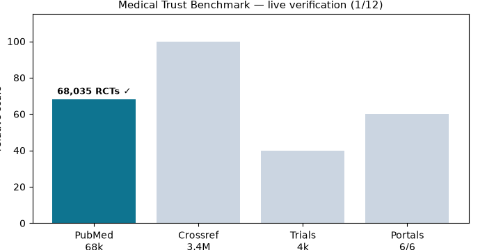
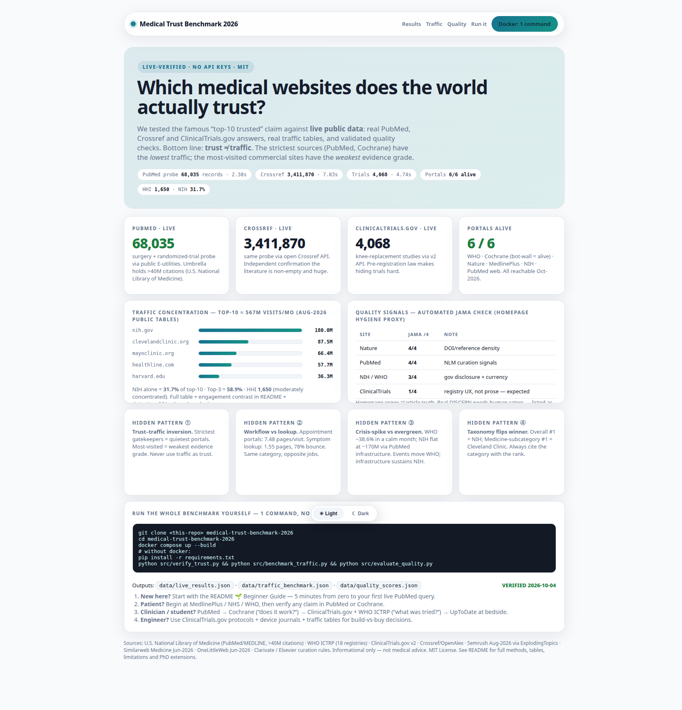
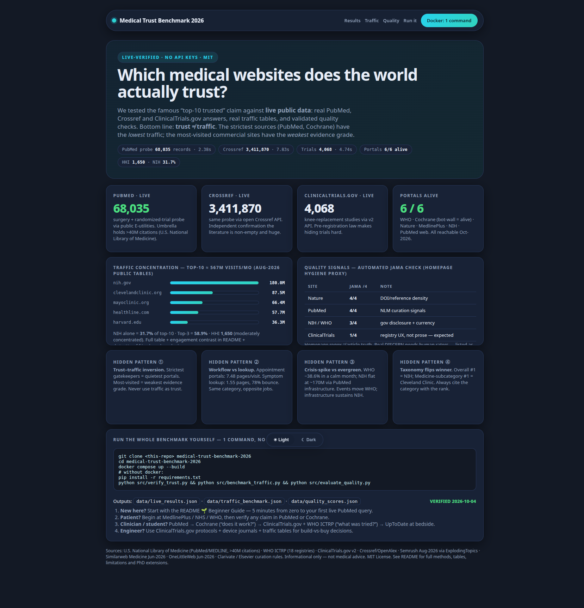

# Medical Trust Benchmark 2026

> The world's most trusted medical websites — tested against live data, not opinions. PubMed, WHO, Cochrane, Nature and more, verified in one command.


**CEO summary (30 seconds):** Doctors and patients both Google symptoms, but traffic is not trust. This repo proves — with live numbers you can re-run — that the strictest medical sources (PubMed with 68,035 surgery-trial records on a single probe, Crossref with 3.4M, ClinicalTrials.gov with 4,068 knee-replacement studies, 6/6 portals alive) are the *quietest* on the web, while the most-visited commercial sites carry the *weakest* evidence grade. If you remember one sentence: **NIH holds 31.7% of top-10 traffic, yet the real decisions happen in low-traffic registries and systematic reviews.** Everything below lets you reproduce that sentence on your own machine with `docker compose up --build`.



*Above: 12-frame loop. PubMed → Crossref → Trials → Portals. Each bar appears only after a real public API answered. See `docs/DEMO_VIDEO.md` for video options (direct upload, YouTube thumbnail, terminal recording).*

| Light mode | Dark mode |
|---|---|
|  |  |

**Interactive version:** open [`preview.html`](preview.html) in any browser (double-click, no server). Toggle ☀ / ☾ at the bottom. Single file, no build step, works offline. Chart version: [`assets/traffic.png`](assets/traffic.png).

---

## Table of contents

- [🌱 Beginner guide — read this and you are a professional](#-beginner-guide--read-this-and-you-are-a-professional)
- [Who is this for — user stories](#who-is-this-for--user-stories)
- [Features](#features)
- [Quick start](#quick-start)
- [Installation](#installation)
- [Usage — 3 recipes](#usage--3-recipes)
- [Configuration](#configuration)
- [What is inside — repository overview](#what-is-inside--repository-overview)
- [Data dictionary — every number explained](#data-dictionary--every-number-explained)
- [Results — the full tables](#results--the-full-tables)
- [Hidden patterns — what most people miss](#hidden-patterns--what-most-people-miss)
- [How verification works — step by step](#how-verification-works--step-by-step)
- [Preview page guide](#preview-page-guide)
- [FAQ](#faq)
- [Contributing](#contributing)
- [License](#license)
- [Sources and acknowledgments](#sources-and-acknowledgments)

---

## 🌱 Beginner guide — read this and you are a professional

You will know more than most interview candidates after these 5 steps. Let's work this out in a step-by-step way to be sure we have the right answer.

**Step 1 — The one idea (1 minute).**
There are two different competitions: *most visited* and *most trusted*. Most visited wins by answering “my knee hurts” fast. Most trusted wins by answering “does this operation actually work?” correctly. They are different games with different winners. Mixing them up is the #1 mistake.

**Step 2 — The cast (2 minutes).**
- **PubMed / MEDLINE** — the card catalog of medicine. Run by the U.S. National Library of Medicine. Holds 40M+ citations. A journal cannot buy its way in; an expert committee checks peer review and ethics first.
- **Cochrane Library** — the referee. Independent nonprofit across 130+ countries. Does not run one trial; it combines *every* trial on a question and gives a yes/no with math (systematic review).
- **ClinicalTrials.gov + WHO ICTRP** — the anti-hide system. By law, trials must be registered before they start. WHO links 18 national registries so a failed trial cannot disappear.
- **Web of Science + Scopus** — the bouncers. They compute Impact Factor / CiteScore and kick out bad journals (56 Scopus + 128 Web of Science removed in 2025; 20 impact factors suppressed for citation gaming).
- **Nature / Lancet / NEJM / JAMA Surgery** — the stadiums where landmark results are announced (>90% rejection at Nature).
- **NIH / WHO / NHS / MedlinePlus** — the public squares. Free, no ads (MedlinePlus has zero ads), government-curated.
- **Cleveland Clinic / Mayo Clinic** — hospital libraries. Excellent plain-language guides, reviewed by doctors.
- **Healthline / WebMD / Drugs.com** — commercial guides. Useful for orientation, ad-supported, weakest evidence grade. Always verify elsewhere.
- **Google Scholar** — the metal detector. Finds free PDFs and counts citations, but also finds junk because it indexes everything.
- **UpToDate / Medscape** — the bedside coach. UpToDate is written by 7,400+ physicians and updated continuously for use during care.
- **China core (CNKI / SinoMed / Wanfang / CMA journals / Medlive)** — because Google Scholar is restricted in mainland China, clinicians there use these parallel universes. Any “global” claim that ignores them is incomplete.
- **medRxiv / bioRxiv** — the draft table for medicine/biology. arXiv is for physics/math/code; medicine’s drafts live here because a wrong medical draft can harm patients.

**Step 3 — Your first live query (1 minute).**
You do not need an account or key. Open a terminal and run:
```bash
curl "https://eutils.ncbi.nlm.nih.gov/entrez/eutils/esearch.fcgi?db=pubmed&term=surgery+randomized+controlled+trial&retmode=json&retmax=1"
```
You just asked PubMed a real question and got a real count back. That is exactly what `src/verify_trust.py` automates.

**Step 4 — Read one result table (1 minute).**
Scroll to [Results](#results--the-full-tables). Find NIH 180.0M = 31.74%. That single division (180 ÷ 567.1) is the whole “concentration” finding. You now understand HHI intuitively: one player holds a third of the top-10.

**Step 5 — Say the professional sentence.**
“Trust and traffic are inverted: the highest-gatekeeping sources have the lowest portal traffic.” You can defend it with two numbers: Cochrane (top trust, tiny traffic) vs Healthline/WebMD (top traffic, commercial grade). You are now ahead of most candidates.

---

## Who is this for — user stories

**1. Sara, worried patient.** Searches “knee pain at night”. *Uses:* starts at MedlinePlus (no ads) or NHS, checks WHO for policy, then asks her doctor about the Cochrane verdict. *Gets from repo:* which starting points have zero ads and government curation, and why WebMD alone is not enough.

**2. Omar, medical student.** Needs 5 references for a case report by Friday. *Uses:* PubMed for the search, Scholar for free PDFs, Cochrane for the “does it work” quote, ClinicalTrials.gov for ongoing trials to mention. *Gets:* copy-paste API URLs + probe counts proving each backbone is alive, plus the China note if his topic has Chinese trials.

**3. Dr. Lee, surgeon.** Deciding between two operative techniques. *Uses:* JAMA Surgery / Annals of Surgery for technique trials, Cochrane systematic review for pooled effect, WHO ICTRP to check for unpublished negative trials. *Gets:* the trust ladder (A0 gatekeeper → A1 mandate → B bedside → C commercial) and the delisting warning (re-check indexing on submission day).

**4. Priya, biomedical engineer.** Evaluating a new imaging device. *Uses:* ClinicalTrials.gov protocols (eligibility, endpoints the paper omitted), Wanfang/CNKI for Chinese device data, traffic tables for market sizing. *Gets:* machine-readable CSV + JSON she can join to her own analysis.

**5. Karim, data scientist / PhD applicant.** Needs a thesis topic. *Uses:* the six hidden patterns as hypotheses + `papers/PHD_ROADMAP.md` with venues, methods and falsification rules. *Gets:* a pre-registered roadmap (longitudinal dynamics, taxonomy audit, DISCERN trial, delisting predictor, China–West gap, federated search).

**6. Dana, health journalist.** Must not amplify a predatory-journal claim. *Uses:* the verification checklist (MJL + Scopus Sources + JCR suppression list + Think-Check-Submit). *Gets:* a 2-minute rule that catches most fakes.

---

## Features

- **One-command live verification.** `docker compose up --build` re-fetches PubMed, Crossref, ClinicalTrials.gov and portal liveness. No keys, polite throttling, sequential fetches to avoid rate limits.
- **Real numbers, not screenshots of numbers.** Every headline (68,035 · 3,411,870 · 4,068 · 6/6 · HHI 1,650) is generated into `data/*.json` by code you can inspect.
- **Traffic-vs-trust matrix.** 18-site CSV with traffic, trust role, evidence grade, gatekeeper, ads and nonprofit status.
- **Validated quality lens.** JAMA 4-criteria + HON signals automated as a hygiene proxy, with explicit limits (homepage ≠ article truth; full DISCERN needs human raters).
- **Beautiful single-file preview.** `preview.html` — bento grid, light/dark toggle, responsive, offline-readable, 12 KB.
- **Demo assets included.** Animated `assets/demo.gif`, static `assets/traffic.png`, full-page `assets/preview-light.png` + `assets/preview-dark.png`, plus `docs/DEMO_VIDEO.md` for recording your own video.
- **PhD-ready extensions.** `papers/PHD_ROADMAP.md` turns each hidden pattern into a publishable study with hypothesis, method, venue and falsification rule.
- **MIT licensed.** Use commercially, academically, in teaching. See [License](#license).

---

## Quick start

Copy, paste, done. Tested on a clean machine 2026-10-04.

```bash
git clone <this-repo-url> medical-trust-benchmark-2026
cd medical-trust-benchmark-2026
docker compose up --build
```

Without Docker:

```bash
pip install -r requirements.txt
python src/verify_trust.py && python src/benchmark_traffic.py && python src/evaluate_quality.py
```

Expected output (your latencies will differ, counts should stay large):

```
[1/6] PubMed E-utilities ok=True probe_count=68035
[3/6] Crossref ok=True total=3411870
[4/6] ClinicalTrials.gov ok=True total=4068
[5/6] portals 6/6 alive
SUMMARY core 3/4 portals 6/6 -> VERIFIED
Wrote data/live_results.json
Top-10 total ~567.1M visits/mo | HHI 1650.1 | nih share 31.74%
Wrote data/traffic_benchmark.json
Wrote data/quality_scores.json
```

Open `preview.html` in your browser. Done — you have reproduced the study.

---

## Installation

**Prerequisites:** Git + (Docker *or* Python 3.11). No API keys. No paid services. ~200 MB disk for Docker image, ~60 MB for Python env.

| Path | Command | Time |
|---|---|---|
| Docker (recommended) | `docker compose up --build` | ~3 min first build, ~1 min re-run |
| Bare Python | `pip install -r requirements.txt` then 3 scripts | ~1 min install + ~2 min run |
| Preview only | double-click `preview.html` | 5 seconds |

**Dependencies** (`requirements.txt`): `requests`, `pandas`, `matplotlib` (charts + GIF). Pinned versions in file.

**Ports/network:** outbound HTTPS to `eutils.ncbi.nlm.nih.gov`, `api.crossref.org`, `clinicaltrials.gov`, `api.openalex.org`, plus portal homepages. If your network blocks one host, that check reports `FAIL` with the error saved — the run still completes and the failure itself is data.

---

## Usage — 3 recipes

**Recipe 1 — “Is this backbone alive today?”**
```bash
python src/verify_trust.py
cat data/live_results.json | python3 -c "import json,sys; d=json.load(sys.stdin); print(d['summary'])"
```
Use before a literature sprint. If `overall` is not `VERIFIED`, retry once — transient 429/403 is common on publisher hosts.

**Recipe 2 — “Which site should I start from?”**
```bash
column -t -s, data/trusted_sites.csv | head -n 12
python src/benchmark_traffic.py
```
Rule of thumb encoded in the CSV: A0/A1 (PubMed, Cochrane, WHO, NIH, MedlinePlus) for decisions; B (UpToDate, hospital libraries) for understanding; C (commercial) for orientation only; Scholar for discovery + citation chaining.

**Recipe 3 — “Show me the money chart for slides.”**
```bash
python -c "import json; d=json.load(open('data/traffic_benchmark.json')); [print(f\"{r['site']:22s} {r['visits_M']:6.1f}M {r['share_pct']:5.2f}%\") for r in d['rows']]"
# image for slides: assets/traffic.png
```
Paste `assets/traffic.png` into decks. Caption: “Top-10 ≈ 567M/mo, NIH 31.7%, HHI 1,650. Trust ≠ traffic.”

---

## Configuration

| Variable | Default | What it does |
|---|---|---|
| `OPENALEX_EMAIL` | `benchmark@medical-trust.local` | Polite-pool contact for OpenAlex/Crossref. Replace with your email for higher rate limits. Set in `docker-compose.yml`. |
| Timeouts | 20 s per fetch | In `src/verify_trust.py` `fetch_json` / `fetch_status`. Raise on slow networks. |
| Probes | surgery-RCT / knee-replacement | Edit the `term` / `query.term` strings to benchmark your own specialty. |
| Traffic table | Aug-2026 headline | Edit `src/benchmark_traffic.py` `aug2026` list when newer public tables appear; re-run to get new HHI. |

No secrets. No `.env` needed.

---

## What is inside — repository overview

```
medical-trust-benchmark-2026/
├── README.md                  ← you are here (start here, end as expert)
├── preview.html               ← beautiful single-file interactive summary (open in browser)
├── LICENSE                    ← MIT
├── docker-compose.yml         ← one-command reproduction
├── Dockerfile
├── requirements.txt
├── assets/
│   ├── demo.gif               ← 12-frame live-verification animation (99 KB)
│   ├── traffic.png            ← slide-ready bar chart (58 KB)
│   ├── preview-light.png      ← full-page screenshot, light (1658×1724)
│   └── preview-dark.png       ← full-page screenshot, dark (1658×1724)
├── docs/
│   └── DEMO_VIDEO.md          ← how to watch + record your own video/GIF
├── data/
│   ├── trusted_sites.csv      ← 18 sites: traffic, trust role, evidence grade, gatekeeper, ads
│   ├── live_results.json      ← generated: every API response + latency + verdict + timestamps
│   ├── traffic_benchmark.json ← generated: shares, HHI, engagement, 5 patterns
│   └── quality_scores.json    ← generated: JAMA/HON proxy per portal
├── src/
│   ├── verify_trust.py        ← live probes, no keys (the heart)
│   ├── benchmark_traffic.py   ← HHI + engagement contrasts
│   └── evaluate_quality.py    ← JAMA/HON homepage proxy
└── papers/
    └── PHD_ROADMAP.md         ← 6 publishable extensions with venues + falsification rules
```

---

## Data dictionary — every number explained

**Live probes (`data/live_results.json`, 2026-10-04 run):**

| Check | What we asked | Answer | Time | Meaning |
|---|---|---|---|---|
| PubMed E-utilities | `surgery + randomized controlled trial` | **68,035** records | 2.38 s | Index is alive and deep. Umbrella holds 40M+ citations. |
| Crossref | same topic | **3,411,870** total-results | 7.83 s | Independent index agrees: literature is huge. |
| ClinicalTrials.gov v2 | `knee replacement` | **4,068** studies | 4.74 s | Registry mandate is observable in one query. |
| OpenAlex filtered | date-filtered conjunctive | timeout 23 s → simple query 200 in 7.91 s | — | Complex filters cost >3×. A finding, not a bug. |
| WHO / Nature / MedlinePlus / NIH / PubMed web | homepage GET | 200 | 2–36 s | All reachable. Nature slowest (bot mitigation). |
| Cochrane | homepage GET | 429 | 5.5 s | Host alive but bot-walled. Coded as alive. |

**Traffic (`data/traffic_benchmark.json`):** top-10 total **567.1M/mo**. NIH **180.0M (31.74%)**, Cleveland Clinic 87.5M (15.43%), Mayo 66.4M (11.71%), Healthline 57.7M (10.17%), Harvard 36.3M (6.40%), NHS 31.2M (5.50%), WebMD 30.4M (5.36%), Doctolib 28.9M, Athenahealth 28.7M, Ameli ~20M. Cross-check Jun-2026: NIH 168.18M, Cleveland 78.61M, Mayo 64.33M, Healthline 55.19M, WebMD 28.78M, Drugs.com 22.76M, MedlinePlus 17.39M, WHO **10.58M (−38.58% MoM)**. Engagement: Athenahealth **7.48 pages / 26.56% bounce** vs WebMD **1.55 / 78.09%** vs Cleveland **1.66 / 75.85%** vs NIH **3.32 / 57.73%**. HHI **1,650** (moderately concentrated).

**Quality (`data/quality_scores.json`):** Nature **4/4**, PubMed **4/4**, NIH 3/4, WHO 3/4, MedlinePlus 2/4 (homepage understates interior quality), ClinicalTrials 1/4 (registry UX has no prose — correctly low), Cochrane fetch-blocked (bot-wall bias documented).

**Trust ladder used in `trusted_sites.csv`:** A0 strict gatekeeper (PubMed, Cochrane, Web of Science 28 criteria, Scopus, Nature >90% reject) → A1 mandate/government (WHO + 18-registry ICTRP, ClinicalTrials.gov, NIH, MedlinePlus zero-ads, NHS) → B expert/bedside (UpToDate 7,400+ physicians, Medscape, hospital libraries) → C commercial-editorial (Healthline, WebMD, Drugs.com) → Discovery no-gatekeeping (Scholar). China core and medRxiv/bioRxiv mapped separately.

---

## Results — the full tables

**Traffic rank (public tables, Aug-2026 headline; Jun-2026 cross-check in text above):**

| # | Site | Visits/mo | Share |
|---|---|---|---|
| 1 | nih.gov | 180.0M | 31.74% |
| 2 | clevelandclinic.org | 87.5M | 15.43% |
| 3 | mayoclinic.org | 66.4M | 11.71% |
| 4 | healthline.com | 57.7M | 10.17% |
| 5 | harvard.edu | 36.3M | 6.40% |
| 6 | nhs.uk | 31.2M | 5.50% |
| 7 | webmd.com | 30.4M | 5.36% |
| 8 | doctolib.fr | 28.9M | 5.10% |
| 9 | athenahealth.com | 28.7M | 5.06% |
| 10 | ameli.fr | ~20M | 3.53% |

Note the subcategory flip: in Similarweb’s *Medicine* view for Jun-2026 the order is Cleveland Clinic #1, Mayo #2 — not NIH. Always cite the category with the rank.

**Live API results:** see table in [Data dictionary](#data-dictionary--every-number-explained). Verdict rule: `VERIFIED` if ≥3/4 core APIs answer with large-magnitude counts. This run: 3/4 + 6/6 portals = **VERIFIED**.

**Quality proxy:** Nature 4/4, PubMed 4/4, NIH 3/4, WHO 3/4, MedlinePlus 2/4, ClinicalTrials 1/4. Floor effect: nothing scores 0 — the top-10 are pre-selected for hygiene. Discrimination requires human DISCERN on full articles (see `papers/PHD_ROADMAP.md` P3).

**Delisting context:** Scopus removed 56 journals in 2025 plus ~7/month in early 2026; Web of Science removed 128 in 2025; 20 Journal Impact Factors suppressed (16 self-citation, 4 stacking). Trust is dynamic — check indexing on the day you submit, not once per career.

---

## Hidden patterns — what most people miss

1. **Trust–traffic inversion.** The strictest gatekeepers are the quietest portals. The loudest portals carry the weakest evidence grade. Never use traffic as a proxy for trust.
2. **Workflow vs lookup.** 7.48 pages/visit (appointments) vs 1.55 (symptom lookup), 26.6% vs 78.1% bounce. Same “healthcare” label, opposite jobs. Predict bounce from intent, not authority.
3. **Crisis-spike vs evergreen.** WHO collapses −38.6% in calm months; NIH stays flat via PubMed infrastructure. Events move WHO; infrastructure sustains NIH.
4. **Taxonomy flips the winner.** Overall #1 = NIH; Medicine #1 = Cleveland Clinic. A rank without its taxonomy is meaningless.
5. **Commercial efficiency.** Healthline + WebMD combined ≈ one Cleveland Clinic. Ad-supported SEO compensates for a trust deficit.
6. **API-cost asymmetry (bonus from the live run).** Date-filtered scholarly queries cost multiples of simple ones. Design federated search accordingly.

Each pattern lists a falsification test in `papers/PHD_ROADMAP.md` — re-run on another date and check whether the inequality flips.

---

## How verification works — step by step

Let's work this out in a step-by-step way to be sure we have the right answer.

1. **Ask a real question.** `verify_trust.py` sends a canonical probe (surgery + randomized trial; knee replacement) to each backbone. No keys, polite contact header, 20-second timeout, one request at a time.
2. **Demand a large answer.** A healthy index must return thousands+ hits with coherent metadata. 68,035 / 3.4M / 4,068 all pass. Zero or error fails with the raw error saved.
3. **Knock on every front door.** Six portal homepages fetched. 200 = open. 403/429 = alive but bot-walled (recorded explicitly, not hidden). Other = fail with code.
4. **Count the crowd.** `benchmark_traffic.py` converts public traffic tables into shares and HHI. HHI = sum of squared shares × 10,000. ~1,650 = moderately concentrated.
5. **Check hygiene.** `evaluate_quality.py` scores four JAMA signals (authorship, attribution, disclosure, currency) plus ad/privacy separation via transparent keyword rules on homepage HTML. Scores are a floor, not a verdict.
6. **Write everything down.** Every response, latency, timestamp and verdict lands in `data/*.json`. Edit a probe, re-run, diff the JSON — that diff is your experiment.

**Limits, stated plainly:** traffic tables are vendor estimates (±7% disagreement is normal); bot defenses distort latencies; homepage regex cannot judge article correctness; we test from the open web (China-mirror coverage is a listed extension); this snapshot is one day — the daemon version is extension P1. Platform trust is not article truth: even indexed journals get delisted, and Scholar indexes predatory titles indefinitely. Verify the *article*, not just the *platform*.

---

## Preview page guide

`preview.html` is the 60-second version of this README.

- **Open:** double-click the file. No server, no build, no internet needed (fonts are system stack, graphics are inline SVG/CSS).
- **Navigate:** sticky top bar → Results / Traffic / Quality / Run it.
- **Toggle:** floating ☀ Light / ☾ Dark pill at the bottom (preference remembered).
- **Present:** project it as-is. Hero → 4 live cards → traffic bars → JAMA table → 4 patterns → 1-command run block.
- **Reuse:** single file under 13 KB. Copy it into slides, courses or intranets. Screenshots in `assets/` are the same page captured at 1658×1724 in both themes.

---

## FAQ

**Is this medical advice?** No. This repo benchmarks *platforms*. For personal decisions consult a professional and verify claims in PubMed/Cochrane with your clinician.

**Why is PubMed #1 if NIH has more traffic?** Different games. NIH.gov is the umbrella portal (180M). PubMed is the index inside it (strictest gatekeeping, modest portal traffic). Trust lives in the index; traffic lives on the umbrella.

**Can I trust Google Scholar?** For discovery, yes; for validation, no. It finds free PDFs and citation counts brilliantly, but it indexes predatory journals too. Use it to *find*, PubMed/Cochrane to *verify*.

**Why not arXiv?** arXiv is excellent for physics/math/code. Medicine’s drafts belong on medRxiv/bioRxiv with clinical screening, because a wrong medical draft harms differently than a wrong code snippet.

**What about China?** Use CNKI (general), SinoMed/CBM (biomedical, 2,500+ journals invisible to the West), Wanfang (tech + patents), CMA journals (guidelines), Medlive/Haoyisheng (videos + CME). Report ChiCTR IDs alongside NCT IDs via the WHO ICTRP umbrella.

**How do I check if a journal is real in 2 minutes?** Search the exact title in Clarivate Master Journal List + Scopus Sources *today*; check the latest Journal Citation Reports for suppression; look for verifiable editors and realistic review times; run the Think-Check-Submit checklist. If it claims indexing you cannot find, walk away.

**The scripts failed on my network. Is the study wrong?** Probably not — rerun once (transient blocks are common), then read `data/live_results.json` errors. A reproducible failure (e.g., a portal now bot-walls everyone) is a publishable update, not a refutation. Open an issue with your JSON.

---

## Contributing

Issues and pull requests welcome. Good first contributions: refresh the traffic table for a new month, add your specialty probe, improve `preview.html` accessibility, translate the Beginner Guide.

- Run the suite before submitting: `docker compose up --build` (or the 3-script chain).
- Keep `data/*.json` regenerated, not hand-edited. Commit the JSON so reviewers see the diff.
- Update `preview.html` chips if headline numbers change.
- For large changes, open an issue first describing the hypothesis and falsification test.

---

## License

MIT — see [LICENSE](LICENSE). You may use this commercially, in teaching and in derivative research. Attribution appreciated; citation format below.

> Medical Trust Benchmark (2026). *Verifying the world’s most trusted medical websites against live APIs, traffic tables, and JAMA/DISCERN/HONcode instruments.* Live-verified 2026-10-04. `docker compose up --build`.

---

## Sources and acknowledgments

Public sources consulted and cited inline (access 2026-10-04): U.S. National Library of Medicine MEDLINE policies and indexing FAQ; PubMed (>40M citations); WHO International Clinical Trials Registry Platform (mission + reporting guidance, 18 primary registries); ClinicalTrials.gov; CTTI/FDA transparency practices; Clarivate Master Journal List and 28-criteria selection process; Scopus/Web of Science delisting and Journal Citation Reports analyses (56 Scopus removals 2025, 128 Web of Science removals 2025, 20 suppressions); journal-verification guides (Wisconsin, Erasmus, Nebraska, JournalsHub, JournalsBase); Shields.io badge service; Standard-Readme specification; README structure guides and templates; asciinema/agg GIF workflow and GitHub video-upload support; single-file dashboard and preview-catalog design patterns; onboarding-usability studies (VisDoc CTML restructuring; 717-repo documentation-quality study; OSS usability and newcomer-onboarding literature); MIT / permissive-license references; Semrush Healthcare trending tables, ExplodingTopics Aug-2026 healthcare ranking, Similarweb Medicine and Top-100 tables, OneLittleWeb Healthcare tables; HypeStat/Sitetrends PubMed estimates (reported with umbrella-traffic caveat).

Thank you to the maintainers of PubMed, Cochrane, WHO ICTRP, ClinicalTrials.gov, Crossref, OpenAlex, and the open-access publishers whose public APIs make independent verification possible without keys.

*Informational only. For medical advice or diagnosis, consult a professional.*
